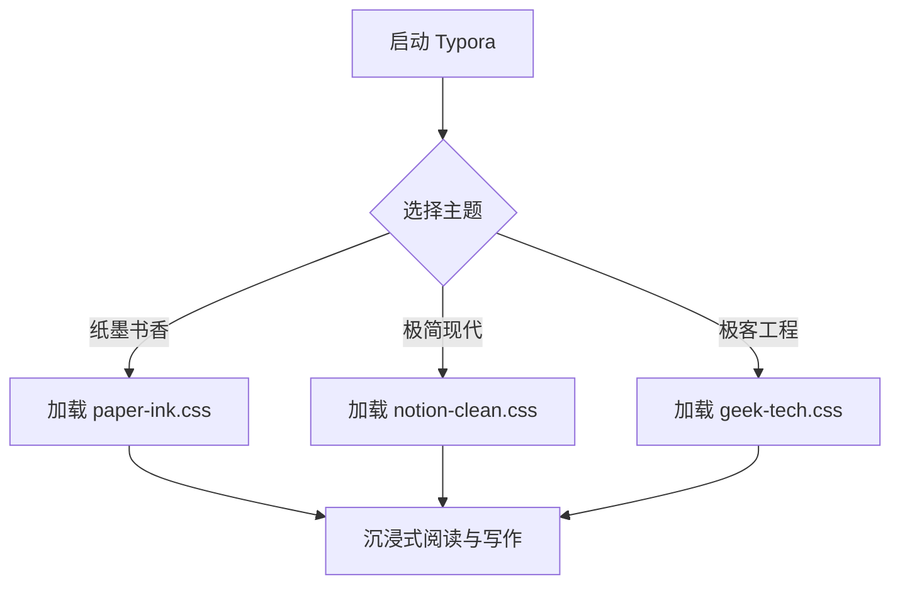
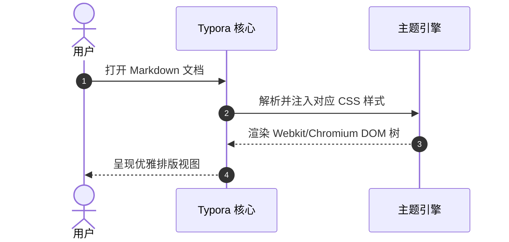

# Typora 全语法特性与排版全要素测试文档

> 本文档汇集了 Markdown 标准语法、CommonMark 规范以及 Typora 原生支持的所有扩展特性（GFM、LaTeX、Mermaid、HTML 标签等）。
> 建议在 Typora 中切换不同主题（如 `paper-ink.css`、`notion-clean.css`、`geek-tech.css`）以全面检验渲染细节。

[TOC]

---

## 1. 标题系统测试 (Headings)

# 一级标题 Heading 1 (2rem+ 大字号、主标题权重)

## 二级标题 Heading 2 (章节分隔线、核心章节)

### 三级标题 Heading 3 (模块小节)

#### 四级标题 Heading 4 (细分子项)

##### 五级标题 Heading 5 (次级细节)

###### 六级标题 Heading 6 (最低级别微型标题)

### 1.1 复合标题测试
### 标题内包含 **粗体**、*斜体*、`Inline Code` 以及 [链接](#) 的视觉对齐测试
### 这是一段非常非常非常长的一行标题用于测试在不同分辨率或移动窗口下标题换行与行高行距（line-height）是否协调

---

## 2. 行内格式与文本样式 (Inline Formatting)

### 2.1 基础文本修饰
- **粗体加重文本 (Bold)**：`**两个星号**` 或 `__两个下划线__`。
- *斜体强调文本 (Italic)*：`*单星号*` 或 `_单下划线_`。
- ***粗体与斜体叠加 (Bold & Italic)***：`***三个星号***`。
- ~~删除线内容 (Strikethrough)~~：`~~已废弃或需剔除的内容~~`。
- <u>下划线文本 (Underline)</u>：`<u>使用 HTML 标签包裹</u>`。
- ==高亮重点标记 (Highlight)==：`==两个等号包裹的荧光高亮==`。
- 上标与下标：水的化学式 H~2~O（下标 `~2~`），爱因斯坦质能方程 E = mc^2^（上标 `^2^`）。
- 键盘按键标签：按 <kbd>Ctrl</kbd> + <kbd>Shift</kbd> + <kbd>P</kbd> 打开命令面板，或按 <kbd>Esc</kbd> 退出。
- 表情符号 (Emoji)：:rocket: :sparkles: :coffee: :art: :books: :bulb: :white_check_mark: :warning:

### 2.2 段落排版与混排
这是一个标准的中文段落。天地玄黄，宇宙洪荒。日月盈昃，辰宿列张。寒来暑往，秋收冬藏。闰余成岁，律吕调阳。雲騰致雨，露結為霜。金生麗水，玉出崑岡。Typography should be designed to delight the eye and elevate the reading experience.

这是连续换行的第二行段落（包含行尾强制换行符）<br>
这是通过 `<br>` 标签实现的段内换行效果，行间距应该小于段落间距（Paragraph Margin）。

这是一段包含超长英文单词与无空格链接的排版测试，用于验证 `word-break: break-word` 是否正常生效：
Supercalifragilisticexpialidocious https://theme.typora.io/doc/Write-Custom-Theme/VeryLongUrlTestingParameterWithManyCharactersToTestContainerOverflowAndWrappingBehaviorWithoutBreakingLayout

---

## 3. 链接、图像与脚注 (Links, Images & Footnotes)

### 3.1 链接样式
- 标准行内链接：[Typora 官方网站](https://typora.io)
- 带悬浮提示文本的链接：[访问 GitHub 首页](https://github.com "GitHub: Where the world builds software")
- 自动链接：<https://github.com/typora> 以及邮箱链接：<support@typora.io>
- 参考样式链接：这是一个通过文末引用的 [参考链接][ref-link]。
- 页内锚点跳转：[跳转回本文档目录](#typora-全语法特性与排版全要素测试文档)

[ref-link]: https://markdown.com.cn "Markdown 官方教程"

### 3.2 图像嵌入
图像行内居中与描述测试：


### 3.3 脚注系统
这是一个带有学术注解的句子[^note1]。这里是第二个带有简短补充说明的段落[^note2]。

[^note1]: 这是脚注 1 的详细内容，包含对上文技术概念的补充说明与文献引用来源。
[^note2]: 这是脚注 2 的内容，支持行内公式 $a^2 + b^2 = c^2$ 与 `代码片段`。

---

## 4. 列表与清单 (Lists & Tasks)

### 4.1 无序列表与多级嵌套
- 第一级无序列表项 A
  - 第二级无序列表嵌套 A-1
    - 第三级深层嵌套 A-1-a
    - 第三级深层嵌套 A-1-b
  - 第二级无序列表嵌套 A-2
- 第一级无序列表项 B
- 第一级无序列表项 C（包含多段落内容）

  这是列表项 C 内部缩进的辅助说明文字段落，理应与父级列表项对齐。

### 4.2 有序列表
1. 环境准备：安装 Typora 并在偏好设置中启用开发者调试模式。
2. 目录联接：使用 `mklink /J` 将开发目录链接到 `%APPDATA%\Typora\themes`。
3. 样式开发：
   1. 优先定义 `:root` 基础变量。
   2. 覆盖正文排版（`html`, `body`, `#write`）。
   3. 调整标题与代码高亮。
4. 综合回归测试。

### 4.3 任务清单 (Task Lists)
- [x] 已完成的核心目标：建立清晰的 CSS 变量调色盘
- [x] 已适配的排版细节：Rem 弹性字号缩放机制
- [ ] 待优化的细节：检查 Windows Unibody 边框表现
- [ ] 待适配的特性：Mermaid 复杂图表在主题下的色彩对比度


---

## 5. 引用块 (Blockquotes)

### 5.1 单行与多行引用
> 博学之，审问之，慎思之，明辨之，笃行之。
> 
> ——《礼记·中庸》

### 5.2 复杂内容与多层嵌套引用
> ### 引用块内的标题测试
> 
> 引用块内可以容纳多种 Markdown 元素，比如行内代码 `git checkout -b feature`，以及带格式的文字 **加粗** 与 *斜体*。
> 
> > 这是第二层嵌套引用。测试多层缩进时的边框颜色递进与背景对比度。
> > > 这是第三层嵌套引用。层层递进时排版不应混乱。
> 
> 退出多层嵌套后的一级引用内容。

### 5.3 提示卡片 Callouts（GFM Alerts）

> [!NOTE]
> 这是一个提示卡片（NOTE）：用于突出显示用户在浏览内容时应当注意的有用信息，即使进行快速浏览也应留意。

> [!TIP]
> 这是一个技巧卡片（TIP）：提供有帮助的提示与捷径，帮助用户更高效地完成任务。

> [!IMPORTANT]
> 这是一个重要卡片（IMPORTANT）：呈现用户为了实现目标所必需的关键信息。

> [!WARNING]
> 这是一个警告卡片（WARNING）：提示需要立即关注的关键内容，用于避免潜在风险或错误。

> [!CAUTION]
> 这是一个谨慎卡片（CAUTION）：提醒用户注意某些操作可能带来的负面后果或危险性。

---

## 6. 表格 (Tables)

### 6.1 常用对齐方式表格
| 左对齐表头 (Left) | 居中对齐表头 (Center) | 右对齐表头 (Right) | 默认对齐 (Default) |
| :--- | :---: | ---: | --- |
| 文本左侧对齐 | 居中状态标记 | 金额 / 数值 | 默认排版 |
| `paper-ink.css` | 🟢 完备 | ¥ 0.00 | 宣纸米白宋体 |
| `notion-clean.css` | 🟢 完备 | ¥ 0.00 | 纯净无界卡片 |
| `geek-tech.css` | 🟢 完备 | ¥ 0.00 | GitHub 极客蓝 |
| 行内代码 `const x = 1` | **加粗状态** | 99.9% | 包含 [链接](#) |

### 6.2 宽表格溢出与换行测试
| 模块名称 | 参数类型 | 是否必填 | 默认值 | 详细描述说明（测试超长文字在表格单元格中的换行与填充留白情况） |
| --- | --- | :---: | --- | --- |
| `themeName` | `string` | 是 | 无 | 遵循规范的主题唯一英文标识符，只能由小写英文、数字和短横线连字符组成。 |
| `enableDarkMode` | `boolean` | 否 | `false` | 是否开启随操作系统深浅模式自动跟随媒体查询（浅色专用主题通常保持为否）。 |
| `fontSizeBase` | `string` | 否 | `16px` | 根元素基准字号，供整个编辑器的 `rem` 相对单位进行全局线性缩放。 |

---

## 7. 代码块与语法高亮 (Code Blocks)

### 7.1 行内代码
在文本中调用 `document.querySelector('#write')` 获取写作根节点，或者运行 `npm run dev` 启动测试服务。

### 7.2 JavaScript / TypeScript
```typescript
interface ThemeConfig {
    name: string;
    version: string;
    author: string;
    isLightMode: boolean;
}

/**
 * 校验主题配置是否符合 Typora 规范
 */
function validateTheme(config: ThemeConfig): boolean {
    const nameRegex = /^[a-z0-9-]+$/;
    if (!nameRegex.test(config.name)) {
        console.warn(`[Warning] 主题名 "${config.name}" 必须全部由小写字母、数字和连字符组成！`);
        return false;
    }
    console.log(`主题 "${config.name}" 校验通过，正在加载资源...`);
    return true;
}

const myTheme: ThemeConfig = {
    name: "paper-ink",
    version: "1.0.0",
    author: "Cline",
    isLightMode: true
};

validateTheme(myTheme);
```

### 7.3 Python
```python
import os
import re
from typing import Dict, Optional

class MarkdownParser:
    """Markdown 文档解析与主题校验器"""
    
    def __init__(self, filename: str) -> None:
        self.filename = filename
        self.content: str = ""

    def load(self) -> Optional[str]:
        if not os.path.exists(self.filename):
            raise FileNotFoundError(f"文件不存在: {self.filename}")
        with open(self.filename, "r", encoding="utf-8") as f:
            self.content = f.read()
        return self.content

    def count_headings(self) -> Dict[str, int]:
        pattern = r"^(#{1,6})\s+(.*)$"
        matches = re.findall(pattern, self.content, re.MULTILINE)
        stats = {f"H{len(h[0])}": 0 for h in matches}
        for level, _ in matches:
            stats[f"H{len(level)}"] += 1
        return stats

if __name__ == "__main__":
    parser = MarkdownParser("测试.md")
    print("解析结果:", parser.count_headings())
```

### 7.4 HTML / CSS
```html
<!DOCTYPE html>
<html lang="zh-CN">
<head>
    <meta charset="UTF-8">
    <title>Typora 主题测试页面</title>
    <style>
        :root { --main-color: #2d5a4c; }
        body { font-size: 16px; background-color: #fcfbf7; }
        .card { border: 1px solid #e5dfd3; border-radius: 4px; padding: 16px; }
    </style>
</head>
<body>
    <div class="card" id="app">
        <h1 class="title">纸墨书香</h1>
        <p>静水流深，沧笙踏歌。</p>
    </div>
</body>
</html>
```

### 7.5 Shell / Bash
```bash
#!/usr/bin/env bash
# 自动化主题链接脚本

TARGET_DIR="$APPDATA/Typora/themes"
SOURCE_DIR="$HOME/code/typora-theme"   # 改成你自己的主题仓库路径

echo "==> 正在同步主题样式到 Typora 系统目录..."
cp "$SOURCE_DIR/paper-ink.css" "$TARGET_DIR/"
cp "$SOURCE_DIR/notion-clean.css" "$TARGET_DIR/"
cp "$SOURCE_DIR/geek-tech.css" "$TARGET_DIR/"

echo "==> 同步完成！请重启 Typora 或在主题菜单中选择切换。"
```

### 7.6 JSON / YAML
```json
{
  "name": "typora-theme-suite",
  "version": "1.0.0",
  "private": true,
  "themes": [
    { "id": "paper-ink", "style": "classical-serif", "darkMode": false },
    { "id": "notion-clean", "style": "modern-minimalist", "darkMode": false },
    { "id": "geek-tech", "style": "developer-focused", "darkMode": false }
  ],
  "keywords": ["typora", "theme", "markdown", "light-mode"]
}
```

---

## 8. 数学公式与 LaTeX (MathJax)

### 8.1 行内公式
行内质能方程为 $E = mc^2$，欧拉恒等式为 $e^{i\pi} + 1 = 0$。以及带有积分号的式子：$\int_{-\infty}^{+\infty} e^{-x^2} dx = \sqrt{\pi}$。

### 8.2 块级数学公式
高斯积分与正态分布概率密度函数：

$$
f(x) = \frac{1}{\sigma \sqrt{2\pi}} \exp\left( -\frac{(x - \mu)^2}{2\sigma^2} \right)
$$

多元矩阵运算展示：

$$
\mathbf{X} = \begin{bmatrix}
x_{11} & x_{12} & \cdots & x_{1n} \\
x_{21} & x_{22} & \cdots & x_{2n} \\
\vdots & \vdots & \ddots & \vdots \\
x_{m1} & x_{m2} & \cdots & x_{mn}
\end{bmatrix}, \quad
\mathbf{Y} = \mathbf{X}\mathbf{W} + \mathbf{b}
$$

---

## 9. 图表渲染测试 (Diagrams)

### 9.1 Mermaid 流程图 (Flowchart)


### 9.2 Mermaid 时序图 (Sequence Diagram)


---

## 10. HTML 扩展标签与特殊排版

### 10.1 折叠详情块 (Details & Summary)
<details>
<summary><b>点击展开查看高级主题调优提示</b></summary>
<div style="margin-top: 10px; padding: 10px; border-left: 3px solid #2d5a4c; background: rgba(0,0,0,0.03);">
    <p>1. <b>基准字号</b>：必须定义在 <code>html</code> 上，才能支持 Typora 偏好设置中的全局缩放滑块。</p>
    <p>2. <b>浅色模式安全</b>：<code>body</code> 的背景色必须设为浅色（Hex/RGB），否则 Windows/Linux 会误切入深色模式 UI。</p>
</div>
</details>

### 10.2 原生对齐与排版标签
<p align="center">
    <b>居中对齐文本测试</b><br>
    <small style="color: #888;">落霞与孤鹜齐飞，秋水共长天一色。</small>
</p>

### 10.3 语义化标签与徽章
- 强调语义：<ins>新插入的内容 (ins)</ins>
- 较小字体：<small>版权声明与细则 (small)</small>
- 文本标记：<mark>原生 Mark 高亮标签</mark>

---

## 11. 分割线与文档结语

文档中常规分割线：

***

到这里，Typora 的主要排版特性（标题、段落、行内样式、引用、任务列表、表格、多语言代码块高亮、公式、Mermaid 图表、折叠组件）均已测试完毕。可以在 Typora 的 `主题 (Theme)` 菜单中随意切换，观察各主题的色彩一致性、间距呼吸感与视觉细节！

